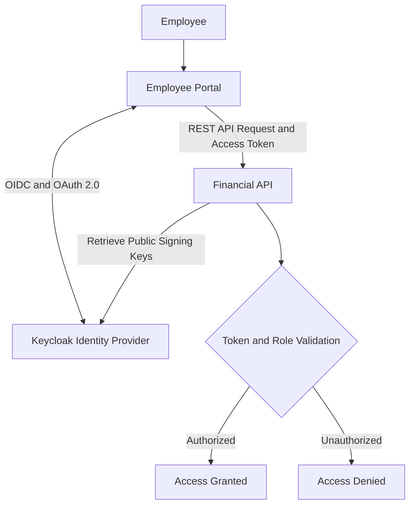

# Enterprise Authentication & Authorization Lab

## Project Overview

Northstar Financial is a simulated enterprise identity and access management environment designed to demonstrate modern authentication, authorization and API security mechanisms.

The project integrates Keycloak with a Python Flask application and a protected financial REST API using industry-standard identity protocols.

## Technologies Used

- Keycloak
- Python
- Flask
- Authlib
- PyJWT
- REST APIs
- OpenID Connect (OIDC)
- OAuth 2.0
- JSON Web Tokens (JWT)
- JSON Web Key Set (JWKS)
- Role-Based Access Control (RBAC)
- Proof Key for Code Exchange (PKCE)

## System Architecture



## Implemented Features

### Identity and Authentication

- Keycloak realm and user management
- OIDC authorization code flow
- PKCE using S256
- Identity provider discovery
- ID token inspection
- JWT header and payload analysis
- JWKS and public signing key identification
- Application session management
- Identity provider logout
- Authentication event logging

### Authorization and API Security

- OAuth 2.0 access token integration
- Protected financial REST API
- Realm role configuration
- Role-based access control
- Custom audience mapping
- Bearer token authentication
- JWT signature verification
- Token issuer, audience and expiration validation

## Authorization Test Results

| Test Scenario | Expected Response | Result |
|---|---|---|
| Request without an access token | 401 Unauthorized | Passed |
| Valid token without finance role | 403 Forbidden | Passed |
| Valid token with finance role | 200 OK | Passed |

These tests demonstrate the separation between authentication and authorization and the enforcement of role-based access policies.

## Repository Structure

- `app.py` - Employee portal and OIDC integration
- `finance_api.py` - Protected financial REST API
- `README.md` - Project overview and documentation

## Running the Lab

### Prerequisites

- Python
- Keycloak
- Required Python packages

Install the Python dependencies:

```bash
python -m pip install flask authlib requests "PyJWT[crypto]"
```

Configure a Keycloak realm named `northstar` with the appropriate OIDC client, realm roles and API audience mapper.

Start Keycloak in development mode.

Generate a Flask session secret using PowerShell:

```powershell
$env:FLASK_SECRET_KEY = python -c "import secrets; print(secrets.token_hex(32))"
```

Start the employee portal:

```bash
python app.py
```

Start the financial API in a separate terminal:

```bash
python finance_api.py
```

## Future Enhancements

- Multi-factor authentication enforcement
- Active Directory and LDAP user federation
- SAML integration
- Automated authentication and authorization testing
- Production-grade secret management
- HTTPS and deployment hardening

## Project Documentation

The accompanying final project report provides a detailed explanation of the architecture, implementation, security mechanisms and validated test results.

## Security Disclaimer

This project is an educational lab using fictional identities and financial data. It is not intended for production deployment.

Sensitive credentials, private keys, raw tokens and personal information have been excluded from the public repository.
